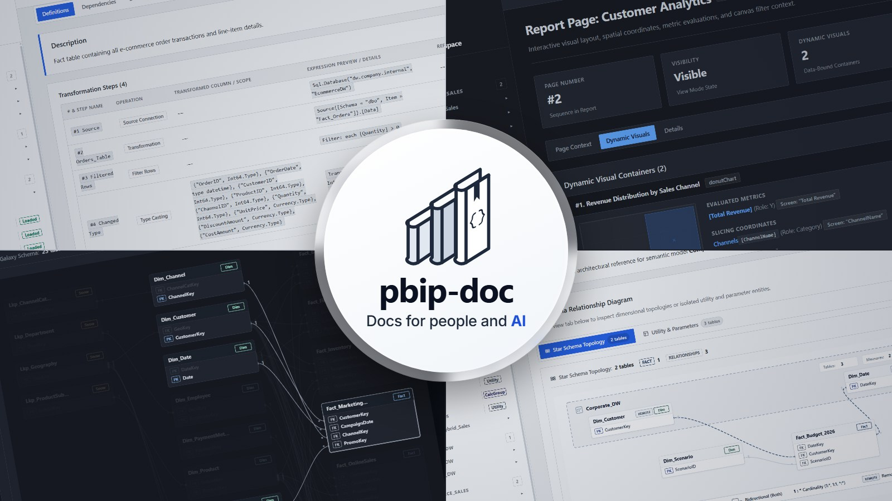

# pbip-doc

> **Automated Documentation, Lineage Resolution, and Knowledge Extraction for Microsoft Fabric & Power BI Projects (`.pbip`).**

[](https://www.python.org/)
[](LICENSE)
[-brightgreen.svg)]()
[]()
[]()
[](ARCHITECTURE.md)



---

## 🎯 Context & Mission

With the emergence of Microsoft Fabric and Power BI Project files (`.pbip`), Business Intelligence development has shifted to modern software engineering practices: semantic models and reports are finally tracked as plain-text source files (TMDL, TMSL/BIM, PBIR) within Git repositories.

However, version-controlled text files do not automatically provide accessible knowledge:

* **The Human Knowledge Access Problem**: Business analysts, data engineers, and BI architects need holistic, immediate visibility into the semantic model:
  * **Obscure Calculation Hierarchies**: Business logic is buried across deeply nested DAX measures, table dependencies, and calculation groups, obscuring true calculation depth and dependency chains.
  * **Buried ETL Data Lineage**: Power Query (M) transformation steps, source connections, and dataflow ingestions are opaque and difficult to trace at a glance across separate table files.
  * **Heavyweight Desktop Lock-in**: Inspecting a data model or report schema traditionally requires launching heavyweight GUI tools (Power BI Desktop, Tabular Editor) that cannot run in headless CI/CD runners or automated environments.
  * **Absence of Dedicated Documentation Tooling**: The BI ecosystem lacks headless, CLI-driven living documentation generators. Teams are forced to manually maintain static Word/Excel data dictionaries or wiki pages that drift out of sync immediately.
* **The AI Knowledge Gap**: Generative AI coding assistants, enterprise copilots, and retrieval-augmented generation (RAG) engines require clean, structured, and pre-digested context:
  * **Broken Formula Boundaries**: Naive text splitters slice long DAX expressions and nested M queries mid-clause, destroying semantic integrity and syntax validity during chunking.
  * **Missing Graph & Topology Metadata**: Standard vector indexes lack calculation depth, table-relationship cardinalities, and upstream/downstream lineage needed for hybrid filtering and precise graph retrieval.
  * **Context Window Pollution**: Raw, unfiltered TMDL/TMSL dumps contain redundant visual formatting, display folders, and layout hashes that dilute model attention and waste token budget.
  * **Unstructured Ingestion Burden**: Without an automated compiler producing self-contained semantic markdown units (complete with YAML frontmatter), AI agents must parse and reconstruct relational topology on the fly.

**The Mission of `pbip-doc`**: Provide a fast, headless, zero-dependency static analysis engine that reads raw PBIP repositories and compiles their complete semantic architecture into two distinct, high-fidelity formats:
1. **For Humans**: A self-contained, offline Zero-JS HTML Enterprise Wiki Portal with collapsible `<details>` sidebar tree navigation, pure-CSS tab switching, embedded interactive vector relationship diagrams (hover-focus), and build-time Light/Dark/Auto theming.
2. **For AI Systems**: Atomic, pre-chunked Markdown documentation with structured YAML frontmatter, engineered specifically for vector databases and enterprise RAG retrieval.

---

## 💡 The Solution: How `pbip-doc` Delivers the Mission

Instead of connecting to a live Analysis Services database or launching external rendering processes, `pbip-doc` performs **direct static analysis** on source files in the file system.

```text
┌─────────────────────────────────┐
│     PBIP / Fabric Source        │
│  - TMDL / TMSL Semantic Models  │
│  - PBIR / Legacy Reports        │
└────────────────┬────────────────┘
                 │
                 ▼
┌─────────────────────────────────┐
│   Static Analysis Engine        │ ◄── Pure Python Standard Library
│  - Power Query M Lineage        │     (Zero runtime dependencies)
│  - Star/Snowflake Classifier    │
│  - DAX DAG & Depth Resolver     │
│  - Visual Canvas Geometry       │
└────────────────┬────────────────┘
                 │
        ┌────────┴────────┐
        ▼                 ▼
┌──────────────┐   ┌──────────────┐
│  For Humans  │   │   For AI     │
│  Offline HTML│   │  RAG-Ready   │
│  Wiki Portal │   │   Markdown   │
└──────────────┘   └──────────────┘
```

### Key Architectural Pillars

* **Zero External Dependencies**: Implemented entirely with the Python Standard Library (`re`, `json`, `pathlib`, `dataclasses`, `argparse`, `math`, `html`, `base64`). It runs in restricted, air-gapped corporate environments without `pip install` supply-chain risks.
* **Multi-Artifact Workspace Discovery**: Recursively detects all semantic models and reports across a repository, building a consolidated catalog with directory hierarchies and composite model mapping.
* **End-to-End M Lineage Resolution**: Parses Power Query M syntax (`let...in`, item access, custom functions) to trace data flows from physical storage endpoints (SQL Server, Lakehouse, SharePoint, OData, Web) through intermediate staging queries down to model tables.
* **Automated Topology & DAX DAG**: Automatically identifies Fact, Dimension, Snowflake Outrigger, and Bridge tables, while calculating directed acyclic graphs (DAGs) for DAX measures to determine calculation depth and downstream impact.
* **Pure Vector SVG Architecture**: Generates interactive Star/Snowflake relationship diagrams and visual mini-maps entirely in standard vector SVG, avoiding external renderers (Graphviz, Mermaid, Canvas) or JavaScript execution.
* **Zero-JS Offline Safety**: The generated HTML portal uses pure HTML5 & CSS (`<details>` collapsible sidebar tree, `:checked` tab switching, CSS grid/flexbox, and `prefers-color-scheme: dark` support in `auto` theme mode alongside build-time `--theme auto|light|dark`). It functions over the local `file://` protocol without JavaScript, hosting requirements, or browser security warnings.

---

## 🚀 Installation & Quickstart

### Installation

`pbip-doc` supports standard Python packaging as well as direct execution without installation:

```bash
# Option A: Install directly from GitHub (recommended before PyPI release)
# Exposes the `pbip-doc` command directly in your PATH
pip install git+https://github.com/mazzolenifsimone/pbip-doc.git

# Or clone and install in editable mode locally:
git clone https://github.com/mazzolenifsimone/pbip-doc.git
cd pbip-doc
pip install -e .

# Option B: Clone and run directly without installing (Zero setup)
git clone https://github.com/mazzolenifsimone/pbip-doc.git
cd pbip-doc
python -m pbip_doc --help
```

> [!NOTE]
> Once published on PyPI, standard installation via `pip install pbip-doc` will also be available.

---

### Core Usage Examples

> [!TIP]
> **Try it immediately on the bundled sample:**
> ```bash
> pbip-doc docgen samples/Ecommerce_Sales -o ./docs -f both
> # Or running without installing:
> python -m pbip_doc docgen samples/Ecommerce_Sales -o ./docs -f both
> ```

#### 1. Document a Single Model or Workspace
Generate both the HTML Enterprise Wiki Portal and the AI RAG-ready Markdown docs:

```bash
# Generate both formats in ./docs
pbip-doc docgen path/to/model_or_workspace -o ./docs -f both
```

*(If running from a git clone without installing, simply use `python -m pbip_doc docgen ...`)*

#### 2. Generate Only the Offline HTML Wiki Portal
```bash
pbip-doc docgen path/to/model_or_workspace -o ./docs -f html
```

For direct hosting on Microsoft SharePoint Online or Microsoft Teams Document Libraries:
```bash
# Generate documentation with .aspx extension for direct SharePoint Online browsing
pbip-doc docgen path/to/model -o ./sharepoint_docs --html-extension aspx
```

#### 3. Generate Only Markdown for AI RAG Ingestion
```bash
pbip-doc docgen path/to/model_or_workspace -o ./kb_docs -f markdown
```

#### 4. Quick Terminal Inspection
Inspect model architecture and DAX depths directly in the console without writing files:

```bash
pbip-doc inspect path/to/model
```

---

## 📂 Output Structure & AI Knowledge Base Format

When compiled with `-f both`, `pbip-doc` organizes generated documentation into clean, isolated directories based on execution mode:

### Workspace Mode (Multi-Model / Multi-Report or `--workspace`)
Used when pointing `docgen` to a directory containing multiple PBIP models/reports, or when forcing `--workspace`:

```text
docs/
├── html/                         ◄── Human Documentation (Open in any browser)
│   ├── index.html                │   Master workspace catalog & global lineage
│   ├── assets/style.css          │   Standalone CSS (Zero external network calls)
│   ├── models/<ModelName>/       │   Model overview (index.html), tables/, measures/, functions/, etl/, diagrams/
│   └── reports/<ReportName>/     │   Report overview (index.html) & visuals/ (canvas layouts, SVG mini-maps)
│
└── markdown/                     ◄── AI Knowledge Base (Ingest into Vector DB / LLM)
    ├── README.md                 │   Master repository index & dependency matrix
    ├── models/<ModelName>/       │   Atomic pages per model
    │   ├── README.md             │   Model catalog & architecture overview
    │   ├── tables/*.md           │   Data dictionaries and column origins
    │   ├── measures/**/*.md      │   DAX formulas with calculation depth metadata
    │   ├── functions/*.md        │   DAX User-Defined Functions (UDFs) & parameter specs
    │   ├── etl/*.md              │   Power Query M code and staging lineage
    │   └── diagrams/*.svg        │   Star/Snowflake & focal relationship SVG diagrams
    └── reports/<ReportName>/     │   Report overview (README.md) & visuals/*.md (visuals/assets/*.svg)
```

### Single-Model Mode (Standalone Model / PBIP Solution)
Used when executing `docgen` on a single semantic model or individual PBIP solution folder without `--workspace`:

```text
docs/
├── html/                         ◄── Human Documentation (Open in any browser)
│   ├── index.html                │   Model dashboard & interactive navigation
│   ├── assets/style.css          │   Standalone CSS (Zero external network calls)
│   ├── tables/*.html             │   Individual table data dictionaries
│   ├── measures/**/*.html        │   DAX measures with dependency cards & visual callouts
│   ├── functions/*.html          │   DAX User-Defined Functions (UDFs) & parameter specs
│   ├── etl/*.html                │   Power Query M lineage & expression documentation
│   ├── diagrams/*.svg            │   Star/Snowflake & focal relationship SVG diagrams
│   └── visuals/                  │   Associated report pages & visuals/assets/*.svg (if present)
│
└── markdown/                     ◄── AI Knowledge Base (Ingest into Vector DB / LLM)
    ├── <ModelName>.md            │   Model overview with architecture & metrics
    ├── tables/*.md               │   Table schemas and column metadata
    ├── measures/**/*.md          │   DAX formulas with calculation depth metadata
    ├── functions/*.md            │   DAX User-Defined Functions (UDFs) & parameter specs
    ├── etl/*.md                  │   Power Query M scripts & upstream dependencies
    ├── diagrams/*.svg            │   Star/Snowflake & focal relationship SVG diagrams
    └── visuals/                  │   Report pages (*.md) & SVG mini-maps in assets/ (if present)
```

### Sample Machine-Readable YAML Frontmatter (Measure)

YAML frontmatter is **enabled by default in generated Markdown files** (can be omitted with `--no-frontmatter`) and is **not included in HTML files**. This allows vector chunkers (Azure AI Search, Pinecone, Qdrant, Chroma) to index semantic attributes as metadata filters:

```yaml
---
title: "Measure: [Net Profit Margin]"
pbip_project: Ecommerce_Sales
entity_name: Net Profit Margin
doc_type: dax_measure
table_name: Orders
calculation_depth: 2
is_base_measure: false
direct_dependencies: [Total Revenue, Total Cost]
all_upstream_dependencies: [Total Revenue, Total Cost]
downstream_measures_count: 1
downstream_measures: [Regional Performance Index]
referenced_tables: [Orders]
referenced_columns:
  - "Orders[GrossAmount]"
  - "Orders[TaxRate]"
tags:
  - semantic_model
  - dax_measure
  - depth_2
  - Orders
  - Net_Profit_Margin
  - Ecommerce_Sales
  - composite_measure
---
# Measure: `[Net Profit Margin]`
...
```

---

## 📋 Comprehensive CLI Reference

The `pbip-doc` command-line interface provides dedicated subcommands for documentation generation, metadata extraction, inspection, and configuration.

### Available Subcommands

Command | Description
:--- | :---
`docgen` | Generates modular Markdown and/or the HTML Enterprise Wiki Portal.
`extract` (alias: `parse`) | Parses a semantic model and exports a normalized, single-source-of-truth JSON metadata model.
`inspect` (alias: `scan`) | Outputs a detailed ASCII summary of model topology, data sources, and DAX DAG depths in the terminal.
`report-extract` | Parses a PBIP `*.Report` folder and exports its visual catalog as JSON.
`report-inspect` | Prints a summary of report pages, visuals, spatial zones, and calculation contexts.
`config` | Displays current defaults (`--show`) or initializes a custom `pbip_doc.config.json` (`--init`).

---

### Detailed `docgen` Command Options

Below is the complete reference of parameters supported by `pbip-doc docgen <path>`:

#### 1. Core & Output Parameters
Flag | Type / Choices | Default | Description
:--- | :---: | :---: | :---
`-o, --output-dir` | Path | `docs/` | Destination directory for generated documentation files.
`-f, --format` | `markdown` \| `html` \| `both` | `html` | Output format to generate.
`--html-extension` | String | `html` | File extension for HTML pages (e.g. `html`, `aspx` for SharePoint Online browsing compatibility, or any custom extension).
`--project-name` | String | *Auto-detected* | Custom project name override for frontmatter metadata and headers.
`--workspace` | Flag | *Auto-detected* | Explicitly forces multi-artifact workspace catalog layout.

#### 2. Scope & Inclusion Filters
Flag | Type / Choices | Default | Description
:--- | :---: | :---: | :---
`--no-model, --no-models` | Flag | `False` | Excludes semantic model documentation (tables, measures, functions, model overview).
`--no-report, --no-reports` | Flag | `False` | Excludes report presentation documentation (pages, visuals, report overview).
`--no-dataflow, --no-dataflows` | Flag | `False` | Excludes Power Query ETL documentation (shared queries, expressions, dataflow overview).
`--no-visuals` | Flag | `False` | Excludes visual-level page documentation.
`--no-visual-svg-maps`| Flag | `False` | Disables rendering of scaled visual SVG layout mini-maps.
`--no-frontmatter` | Flag | `False` | Omits YAML frontmatter at the top of markdown documents.
`--no-m-code` | Flag | `False` | Omits raw Power Query M code snippets from table documents.
`--include-auto-tables`| Flag | `False` | Includes Power BI internal auto-generated date/time tables.
`--include-inherited-entities`| Flag | `False` | Generates dedicated pages for inherited entities and remote measures.
`--exclude-tables` | Comma-separated | `None` | Comma-delimited list of table names to exclude from documentation.

#### 3. Styling, Branding & Visualization
Flag | Type / Choices | Default | Description
:--- | :---: | :---: | :---
`--theme` | `auto` \| `light` \| `dark` | `auto` | Color theme for the HTML portal (`auto` respects OS `prefers-color-scheme: dark`).
`--html-title` | String | *Auto-detected* | Custom title text displayed in the HTML portal header.
`--sidebar-icon` | Preset \| Path \| Inline SVG / Data-URI | `default` | Custom icon for HTML sidebar header: `'default'` (`pbip_doc_logo_large.svg`), presets (`pbip_doc_logo`, `cube`, `database`, `barchart`, `fabric`, `catalog`), path to `.svg`/`.png`, inline `<svg>`/``, or `Data-URI`.
`--no-diagrams, --no-relationship-diagrams` | Flag | `False` | Disables generation of SVG topological relationship diagrams.
`--workspace-grouping`| `folder` \| `flat` | `folder` | Catalog organization: `folder` (by directory) or `flat` (by artifact type).
`--workspace-folder-depth`| Integer | `1` | Subdirectory depth level when `workspace-grouping` is set to `folder`.

#### 4. Custom Paths & Remote Linking
Flag | Type / Choices | Default | Description
:--- | :---: | :---: | :---
`--tables-dir` | String | `tables` | Subdirectory name for table documentation.
`--measures-dir` | String | `measures` | Subdirectory name for measure documentation.
`--functions-dir` | String | `functions` | Subdirectory name for DAX UDF documentation.
`--visuals-dir` | String | `visuals` | Subdirectory name for report page documentation.
`--report-path` | Path | `None` | Explicit path to an associated `*.Report` folder or `report.json`.
`--report-dataset-name` | String | `None` | Override target semantic model name for report visual links when bound to an external dataset.
`--base-doc-url, --base-doc-path` | URL / Path | `None` | Base URL or path used to prefix internal documentation hyperlinks.
`--external-docs-base-url, --external-docs-base-path`| URL / Path | `None` | Base URL or path for cross-linking remote/external semantic models.
`--external-doc-path NAME=URL`| String (Repeated) | `None` | Explicit URL or directory path for a specific upstream external model (overrides `--external-docs-base-url`).

#### 5. Configuration File & Overrides
Flag | Type / Choices | Default | Description
:--- | :---: | :---: | :---
`-c, --config` | Path | `None` | Path to a custom `pbip_doc.config.json` configuration file.
`--layout-config` | Path | `None` | Path to a custom 3-level section layout JSON file.
`--dump-default-layout`| File Path | `None` | Exports default layout configuration JSON to stdout or file and exits.
`--set KEY=VALUE` | Key=Value | `None` | Directly overrides any configuration setting (can be repeated).
`--print-config` | Flag | `False` | Prints the resolved configuration to stdout before execution.

---

## ⚙️ Configuration File Example (`pbip_doc.config.json`)

To standardize settings across your team or CI/CD pipelines, place a `pbip_doc.config.json` file in your repository root or target directory (run `pbip-doc config --show` to inspect all supported keys):

```json
{
  "project_name": "Sales & Revenue Platform",
  "output_format": "both",
  "html_extension": "html",
  "html_theme": "auto",
  "sidebar_icon": "fabric",
  "exclude_auto_date_tables": true,
  "include_relationship_diagrams": true,
  "workspace_grouping": "folder",
  "workspace_folder_depth": 1,
  "excluded_tables": ["_DevScratch", "TempStaging"]
}
```

> [!TIP]
> Setting `"html_extension": "aspx"` enables native in-browser rendering when hosting generated documentation inside Microsoft SharePoint Online or Microsoft Teams Document Libraries.

---

## 🏗️ Technical Architecture & Internal Design

For detailed documentation on the internal engine architecture (Lexer/Parser implementations, AST data structures, Lineage Graph algorithms, and contribution standards), please consult [`ARCHITECTURE.md`](ARCHITECTURE.md).

---

## 🧪 Testing

The test suite runs entirely on the standard Python `unittest` framework:

```bash
# Run all unit tests
python -m unittest discover tests -v
```

---

## 📄 License

This project is licensed under the [MIT License](LICENSE).
